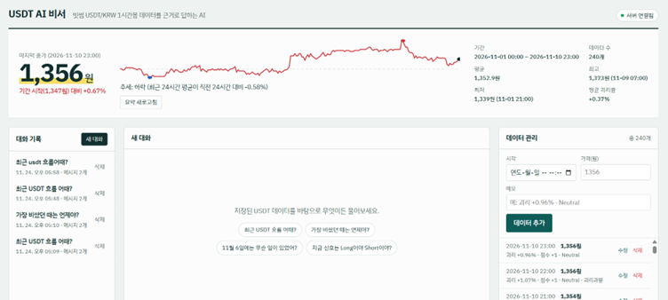
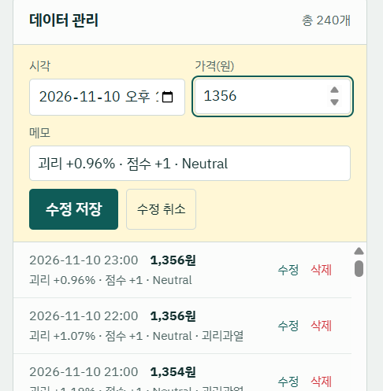
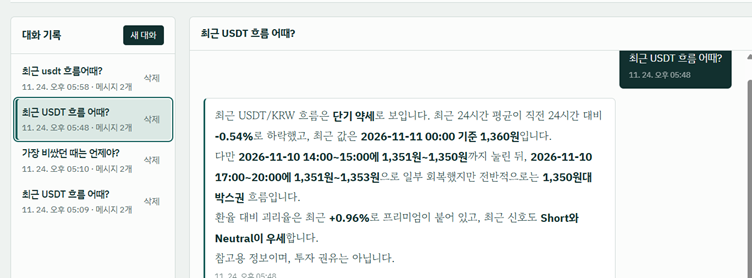

# USDT AI 비서: 내 시장 상황을 아는 AI

빗썸 **USDT/KRW 1시간봉 분석 데이터**를 Firestore에 저장하고, 사용자가 질문하면 **저장된 데이터 요약을 근거로 답하는 AI 채팅 웹 서비스**입니다.

일반 챗봇에게 "요즘 USDT 흐름 어때?"라고 물으면 내가 가진 데이터를 모르기 때문에 일반론으로만 답합니다. 이 서비스는 내가 분석한 240시간 시세, 괴리율(김치 프리미엄), 기술적 지표 신호, 거래량 급증 기록을 AI의 시스템 프롬프트에 넣어서 **"11월 9일 07시 1,373원이 최고가였고, 그때 거래량이 급증했다"** 처럼 내 데이터에 근거한 답을 줍니다.

| 구분 | 주소 |
|---|---|
| 🌐 **프론트엔드 (Vercel)** | https://usdt-ai-assistant-frontend.vercel.app |
| ⚙️ **백엔드 API (Render)** | https://usdt-ai-assistant-mw10.onrender.com |
| 📘 **Swagger UI** | https://usdt-ai-assistant-mw10.onrender.com/docs |
| 💻 GitHub | https://github.com/koyo31068-eunice/usdt-ai-assistant |

> ⏳ **첫 접속 안내:** 백엔드는 Render 무료 플랜이라 한동안 요청이 없으면 잠듭니다. 첫 접속 때 깨어나는 데 **최대 1분 정도** 걸릴 수 있습니다. 화면 상단에 "서버를 깨우는 중" 안내와 경과 시간이 표시되고, 연결되면 자동으로 데이터를 불러옵니다.

---

## 1. 주요 기능

| 기능 | 설명 |
|---|---|
| **① 데이터 기반 AI 채팅** | 질문하면 데이터 요약(기간·개수·평균·최고·최저·추세·괴리율·일별 요약·최근 12시간)을 시스템 프롬프트에 넣어 GPT가 답변합니다. 답변을 기다리는 동안 로딩 표시가 나옵니다. |
| **② 데이터 관리 (CRUD)** | `(date, value, memo)` 형식의 데이터를 화면에서 추가·수정·삭제하고, 목록과 상단 요약이 즉시 갱신됩니다. |
| **③ 대화 기록** | 채팅은 자동으로 저장됩니다. 왼쪽 목록에서 이전 대화를 클릭하면 메시지 전체를 다시 불러오고, 이어서 대화할 수 있습니다. |
| **④ 데이터 요약 보드** | 마지막 종가, 기간 변화율, 240시간 가격 흐름 미니 차트, 추세, 기본 통계를 화면 상단에 표시합니다. |

---

## 2. 기술 스택

| 영역 | 기술 |
|---|---|
| 백엔드 | Python 3.14, **FastAPI**, Uvicorn, Pydantic (입력값 검증), python-dotenv |
| 데이터베이스 | **Firebase Firestore** (firebase-admin) |
| AI | **OpenAI GPT API** (`gpt-5.4-mini`, Chat Completions) |
| 프론트엔드 | **HTML / CSS / JavaScript** (바닐라, 프레임워크 없음) |
| 배포 | 백엔드 **Render** (Web Service, Free), 프론트엔드 **Vercel** (Hobby) |
| 데이터 | 빗썸 Public API USDT/KRW 1시간봉 (2026-11-01 ~ 11-10, 240건) + 지난 시계열 분석 결과 |

```
[브라우저: Vercel]  ──fetch──▶  [FastAPI: Render]  ──▶  [Firestore]
   index.html / app.js            /api/data              data
   config.js ← API_BASE_URL       /api/conversations     conversations
                                  /api/chat  ──────────▶ [OpenAI GPT]
```

---

## 3. 데이터

### 3-1. 데이터 선정
- **대상:** 빗썸 USDT/KRW 1시간봉 종가
- **기간:** 2026-11-01 00:00 ~ 2026-11-10 23:00 (KST), **240개 데이터 포인트**
- **출처:** 지난 시계열 분석 프로젝트(빗썸 Public API 수집 → 괴리율·MACD·Stochastic RSI·Stochastic·BB %B·거래량 이상 징후 분석)의 결과 파일 `backend/data/features_1h.csv`

### 3-2. 저장 형식 (`data` 컬렉션)
| 필드 | 내용 | 예시 |
|---|---|---|
| `date` | 1시간봉 시각 (KST) | `2026-11-09T07:00` |
| `value` | USDT/KRW 종가 (원) | `1373` |
| `memo` | 그 시각의 분석 요약 | `괴리 +0.69% · 점수 +0 · Neutral · 거래량급증 · 괴리과열` |
| `source` | `seed`(초기 업로드) 또는 `api`(화면에서 추가) | `seed` |
| `created_at`, `updated_at` | 저장 시각 | 서버 시간 |

초기 데이터는 `python scripts/seed_data.py`로 업로드합니다. 문서 ID가 시각 기반(`seed_20261109_0700`)이라 다시 실행해도 중복되지 않습니다.

### 3-3. 요약 정보 (`GET /api/data/summary`, 실제 응답 일부)
```json
{
  "period": "2026-11-01 00:00 ~ 2026-11-10 23:00",
  "count": 240,
  "unit": "KRW per USDT (빗썸 USDT/KRW 1시간봉 종가)",
  "metrics": {
    "average": 1352.9, "max": 1373, "max_at": "2026-11-09 07:00",
    "min": 1339, "min_at": "2026-11-01 21:00",
    "first": 1347, "latest": 1356, "latest_at": "2026-11-10 23:00", "change_pct": 0.67
  },
  "trend": "하락 (최근 24시간 평균이 직전 24시간 대비 -0.58%)",
  "premium": { "average_pct": 0.37, "max_pct": 1.32, "latest_pct": 0.96 },
  "signals": { "Long": "...", "Short": "...", "volume_spike_times": ["2026-11-05 23:00", "2026-11-06 00:00", "2026-11-09 07:00"] },
  "daily": ["... 일별 시가·고가·저가·종가 ..."],
  "recent": ["... 최근 12개 (date, value, memo) ..."]
}
```
- **추세 판단:** 최근 24시간 평균과 직전 24시간 평균을 비교해 +0.1% 넘게 오르면 상승, 0.1% 넘게 내리면 하락, 그 사이는 유지(보합)
- **캐시:** 채팅마다 240건을 다시 읽지 않도록 요약을 5분간 메모리에 보관하고, 데이터가 추가·수정·삭제되면 즉시 다시 계산합니다.

---

## 4. API 명세

전체 명세와 직접 실행은 **[Swagger UI](https://usdt-ai-assistant-mw10.onrender.com/docs)** 에서 확인할 수 있습니다.

| 구분 | 메서드 · 경로 | 설명 |
|---|---|---|
| 데이터 | `POST /api/data` | 새 데이터 추가 (201) |
| | `GET /api/data?limit=500&order=desc` | 데이터 목록 조회 |
| | `PUT /api/data/{id}` | 데이터 수정 (보낸 항목만 변경) |
| | `DELETE /api/data/{id}` | 데이터 삭제 |
| | `GET /api/data/summary?refresh=false` | 데이터 요약 (프롬프트 주입용) |
| 대화 기록 | `POST /api/conversations` | 대화 저장 (제목을 비우면 첫 질문으로 자동 생성) |
| | `GET /api/conversations?limit=50` | 대화 목록 조회 |
| | `GET /api/conversations/{id}` | 특정 대화의 전체 messages 조회 (불러오기) |
| | `DELETE /api/conversations/{id}` | 대화 삭제 |
| AI 채팅 | `POST /api/chat` | 요약 조회 → 시스템 프롬프트 주입 → GPT 호출 → 대화 자동 저장 |
| 기본 | `GET /health`, `GET /health/db` | 서버·Firestore 상태 확인 |

### 대화 불러오기 방식 (요구사항 A 방식)
- `GET /api/conversations` 응답에는 **messages를 포함하지 않습니다.** `id`, `title`, `preview`, `message_count`, `created_at`, `updated_at`만 반환해 목록을 가볍게 유지합니다.
- 대화 내용은 **`GET /api/conversations/{id}`** 로 전체 messages를 불러옵니다.

### `POST /api/chat` 요청 · 응답
```json
// 요청 (conversation_id를 생략하면 새 대화, 넣으면 이어서 대화)
{ "message": "최근 USDT 흐름 어때?", "conversation_id": "선택" }

// 응답
{
  "conversation_id": "2DzRtdhOh303GSyKeNDd",
  "reply": "최근 USDT/KRW 흐름은 완만한 하락/횡보입니다. 마지막 값은 2026-11-10 23:00에 1,356원이고 ...",
  "model": "gpt-5.4-mini-2026-03-17",
  "summary_used": { "period": "...", "count": 240, "trend": "하락 (...)" },
  "usage": { "prompt_tokens": 1340, "completion_tokens": 286, "total_tokens": 1626 }
}
```

### 시스템 프롬프트 구조 (`backend/prompt.py`)
```
당신은 빗썸 USDT/KRW 시장 데이터 분석 비서입니다.

[사용자 데이터 요약]
- 데이터 기간: {period} (KST)
- 총 레코드: {count}개
- 주요 지표: 평균 {average}원, 최고 {max}원({max_at}), 최저 {min}원({min_at})
- 기간 변화: {first}원 → {latest}원 ({change_pct}%)
- 최근 트렌드: {trend}
- 환율 대비 괴리율, 통합 신호 시간 수, 거래량 급증 시각
[일별 요약] ... / [최근 12개 데이터] ...

[답변 규칙]
1. 데이터에 근거해 한국어로 간결하게, 숫자는 원 단위와 시각을 함께
2. 데이터에 없는 내용(미래 가격, 뉴스 등)은 추측하지 않고 "저장된 데이터에는 없습니다"
3. 메모의 '점수'는 기술적 지표 4종 통합 점수 (+2 이상 Long, -2 이하 Short)
4. 매수·매도 판단 질문에는 투자 권유가 아닌 참고 정보임을 덧붙임
```

### Firestore 컬렉션 구조
```
data/{자동ID 또는 seed_YYYYMMDD_HH00}
  └ date, value, memo, source, created_at, updated_at

conversations/{자동ID}
  └ title, preview, message_count, created_at, updated_at,
    messages: [ { role: "user" | "assistant", content, created_at }, ... ]
```

---

## 5. 환경 변수

키 값은 코드에 넣지 않습니다. 로컬은 `backend/.env`(GitHub 제외), 배포는 Render·Vercel 대시보드에 입력합니다. 이름 견본은 `backend/.env.example`, `frontend/config.example.js`에 있습니다.

### 최소 세트
| 이름 | 위치 | 설명 |
|---|---|---|
| `OPENAI_API_KEY` | 백엔드 | OpenAI API 키 |
| `FIREBASE_SERVICE_ACCOUNT_JSON` | 백엔드 (Render) | 서비스 계정 키 JSON **내용 전체** |
| `FIREBASE_SERVICE_ACCOUNT_PATH` | 백엔드 (로컬) | 키 파일 경로 (예: `secrets/serviceAccountKey.json`). JSON 변수와 둘 중 하나만 사용 |
| `ALLOWED_ORIGINS` | 백엔드 | CORS 허용 도메인, 쉼표로 구분 |
| `API_BASE_URL` | 프론트엔드 (Vercel) | 백엔드 주소. 배포 시 `build.js`가 `config.js`를 자동 생성 |

### 선택 (기본값 있음)
| 이름 | 기본값 | 설명 |
|---|---|---|
| `OPENAI_MODEL` | `gpt-4.1-mini` | 사용 모델 (배포: `gpt-5.4-mini`) |
| `OPENAI_REASONING_EFFORT` | (빈 값) | 추론형 모델일 때 `low` 권장 |
| `OPENAI_MAX_TOKENS` | `600` | 답변 최대 토큰 (추론형 모델은 `1500`) |
| `CHAT_HISTORY_LIMIT` | `10` | GPT에 함께 보내는 이전 메시지 수 |
| `CHAT_DAILY_LIMIT` | `200` | 하루 최대 채팅 요청 수 (과금 보호) |
| `PYTHON_VERSION` | - | Render용 (`3.14.10`) |

### 배포 설정값
| 서비스 | 설정 |
|---|---|
| **Render** | Root Directory `backend` · Build `pip install -r requirements.txt` · Start `uvicorn main:app --host 0.0.0.0 --port $PORT` · Region Singapore |
| **Render** `ALLOWED_ORIGINS` | `http://127.0.0.1:5500,http://localhost:5500,https://usdt-ai-assistant-frontend.vercel.app` |
| **Vercel** | Root Directory `frontend` · Framework Other · `vercel.json`(빌드 `node build.js`, 출력 `dist`) |
| **Vercel** `API_BASE_URL` | `https://usdt-ai-assistant-mw10.onrender.com` |

---

## 6. 로컬 실행 방법

### 준비물
- Python 3.10 이상
- Firebase 프로젝트 + Firestore 데이터베이스 + 서비스 계정 키(JSON)
- OpenAI API 키

### ① 백엔드
```bash
git clone https://github.com/koyo31068-eunice/usdt-ai-assistant.git
cd usdt-ai-assistant

python -m venv .venv
.venv\Scripts\activate            # Mac/Linux: source .venv/bin/activate
pip install -r backend/requirements.txt

cd backend
# 1) Firebase 서비스 계정 키를 backend/secrets/serviceAccountKey.json 으로 저장
# 2) .env.example 을 복사해 .env 를 만들고 값 입력
copy .env.example .env            # Mac/Linux: cp .env.example .env

python scripts/seed_data.py --dry-run   # 업로드 미리보기
python scripts/seed_data.py             # Firestore 에 240건 업로드
uvicorn main:app --reload               # http://127.0.0.1:8000/docs
```

`backend/.env` 예시 (값은 본인 것으로):
```env
ALLOWED_ORIGINS=http://127.0.0.1:5500,http://localhost:5500
FIREBASE_SERVICE_ACCOUNT_PATH=secrets/serviceAccountKey.json
OPENAI_API_KEY=sk-...
OPENAI_MODEL=gpt-5.4-mini
OPENAI_REASONING_EFFORT=low
OPENAI_MAX_TOKENS=1500
```

### ② 프론트엔드 (새 터미널)
```bash
cd frontend
copy config.example.js config.js     # Mac/Linux: cp config.example.js config.js
python -m http.server 5500
```
브라우저에서 **http://127.0.0.1:5500** 을 엽니다. `index.html`을 더블클릭해 `file://`로 열면 CORS 때문에 동작하지 않습니다.

---

## 7. 폴더 구조
```
usdt-ai-assistant/
├── backend/                     # FastAPI (Render 배포)
│   ├── main.py                  # 앱 생성, CORS, 라우터 등록, /health
│   ├── config.py                # 환경 변수 읽기
│   ├── db.py                    # Firestore 연결 (JSON 또는 파일 경로)
│   ├── schemas.py               # 요청·응답 형식 + 입력값 검증
│   ├── summary.py               # 데이터 요약 계산 (통계·추세·일별)
│   ├── prompt.py                # 시스템 프롬프트 생성
│   ├── routes_data.py           # /api/data (CRUD + summary, 요약 캐시)
│   ├── routes_conversations.py  # /api/conversations
│   ├── routes_chat.py           # /api/chat (요약 주입 → GPT → 자동 저장)
│   ├── scripts/seed_data.py     # 분석 결과 240건 Firestore 업로드
│   ├── data/features_1h.csv     # 지난 시계열 분석 결과
│   ├── requirements.txt
│   └── .env.example
├── frontend/                    # 바닐라 HTML/CSS/JS (Vercel 배포)
│   ├── index.html
│   ├── style.css
│   ├── app.js
│   ├── config.example.js        # API 주소 견본 (config.js 는 GitHub 제외)
│   ├── build.js                 # Vercel: API_BASE_URL → dist/config.js 생성
│   └── vercel.json
├── docs/screenshots/            # 제출 스크린샷
└── .gitignore                   # .env, secrets/, config.js, .venv 등 제외
```

---

## 8. 보안 · 운영 · 비용 관리

| 항목 | 적용 내용 |
|---|---|
| 키 관리 | OpenAI 키·Firebase 키는 `.env`와 배포 대시보드에만 저장. `.gitignore`로 `.env`, `backend/secrets/`, `frontend/config.js` 제외 |
| 입력값 검증 | date 형식(`YYYY-MM-DDTHH:MM`), value > 0, memo 200자, 질문 1,000자, role은 user/assistant만 허용 → 위반 시 422 |
| 예외 처리 | 없는 ID 404, DB 오류 500, OpenAI 키·크레딧·모델 오류는 원인을 한글로 안내(502/503/429) |
| XSS 방지 | AI 답변은 HTML을 먼저 이스케이프한 뒤 굵게·줄바꿈만 표시 |
| 과금 보호 | 답변 토큰 상한, 이전 대화 10개만 전송, 하루 200회 제한, OpenAI 월 예산 한도 설정 |
| Firestore 비용 | 요약 5분 캐시로 채팅마다 전체를 다시 읽지 않음 |
| 콜드스타트 | 접속 시 `/health`를 5초 간격으로 최대 2분 재시도, 안내 배너와 경과 시간 표시 |

---

## 9. 제출 스크린샷

### ① 데이터 요약이 보이는 채팅 화면 (질문 + 답변)


### ② 데이터 관리 화면 (CRUD 동작)


### ③ 대화 기록 화면 (불러오기 동작)


---

## 10. 한계와 개선 방향

- **인증 없음:** 누구나 데이터 추가·삭제와 대화 조회가 가능합니다. 실제 서비스라면 Firebase Authentication 같은 로그인과 사용자별 데이터 분리가 필요합니다.
- **하루 요청 제한은 메모리 기반:** 서버가 재시작(콜드스타트 포함)되면 횟수가 초기화됩니다.
- **정적 데이터:** 2026-11-01 ~ 11-10 구간만 담고 있습니다. 빗썸 API를 주기적으로 수집해 `data`에 자동 추가하면 "지금" 상황을 반영하는 비서로 확장할 수 있습니다.
- **OpenAI 키 만료일:** 현재 키는 2026-12-24에 만료되도록 설정했습니다. 이후에는 새 키를 발급해 Render 환경 변수 `OPENAI_API_KEY`를 교체해야 합니다.

> 본 서비스의 답변은 저장된 과거 데이터에 근거한 참고 정보이며, 투자 권유가 아닙니다.
